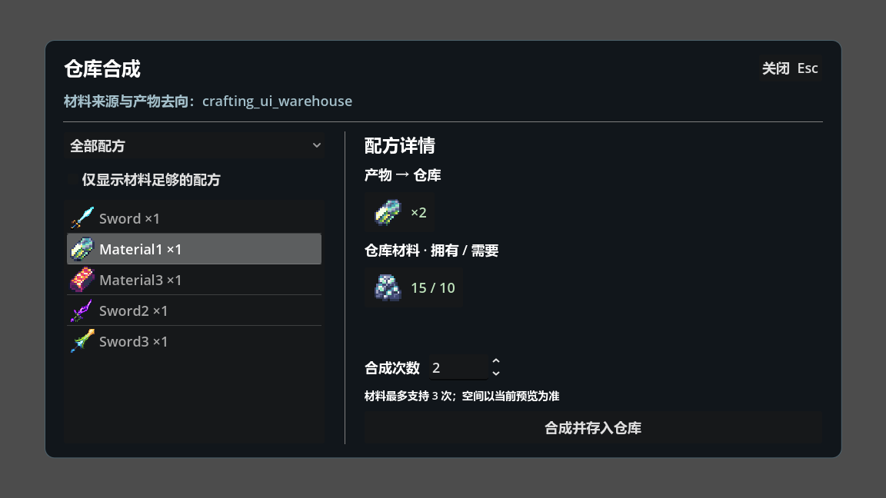
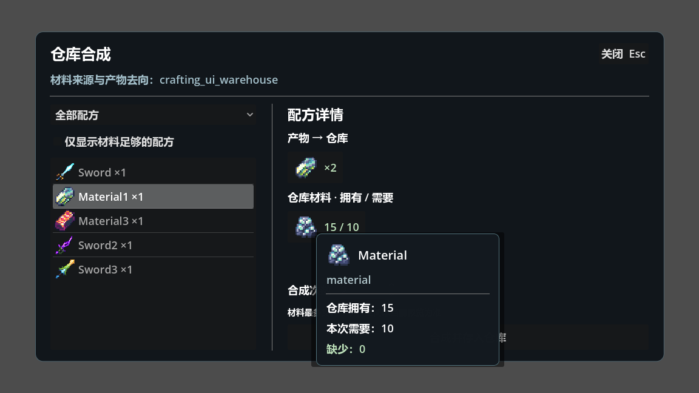

# 仓库合成系统

合成只消耗调用方指定的一个仓库，全部产物写回同一个仓库。不会读取玩家背包、装备栏或其他仓库补料；普通背包作为目标会返回 `UNSUPPORTED`。材料与产物仍由 `InventoryManager` 唯一持有。

## 游戏入口

合成 UI 场景统一位于 `UI/Crafting/`，对应脚本位于 `Script/UI_Script/Crafting/`，与已有 `Script/Gameplay/Crafting/` 和配方配置目录保持同一命名。主界面为 `UI/Crafting/crafting_window.tscn`，根节点为 `CraftingWindow`，通过 `Path.CRAFTING_UI_SCENE` 注册与预加载；独立材料悬浮场景为 `UI/Crafting/material_tooltip.tscn`。场景和脚本 UID 随文件保留。

在家园仓库处按 **E** 存入材料，再按 **K** 打开“仓库合成”，默认绑定 `warehouse_home`，Esc 或关闭按钮关闭。仓库由原有新游戏流程与世界交互物创建，合成窗口只绑定既有仓库，不创建演示物品，不在关闭时清空库存。仓库未注册时显示原因并禁用确认。

显式打开其他仓库：

```gdscript
UIManager.open(UIId.EQUIPMENT, {"warehouse_id": "warehouse_home"})
```

左侧按产物主类型筛选配方，配方总览显示产物图标、名称和每次产出数量，支持“仅显示材料足够的配方”。此筛选按执行一次需要的材料判断，容量由右侧完整预览判断。右侧的产物和材料均只显示图标与数量，不显示物品名称；材料数量为“拥有 / 需要”，不足时标红。鼠标悬浮在材料图标或数量上，会显示材料名称、描述、仓库拥有量、本次所需量及缺少量，有合成配方时还会提示“点击查看合成配方”；提示随库存和合成次数更新。次数范围为 1～999。材料次数上限也限制为 999，不代表这些次数的产物都能放下。



点击右侧所需材料的图标或数量，可在同一窗口跳转到该材料的合成配方，左侧总览同步选中；没有对应配方时不跳转。目标被分类或材料筛选隐藏时会解除筛选，合成次数重置为 1，仓库保持不变。材料不足也能查看其配方；同一材料有多份配方时进入目录中的第一份。点击产物不触发跳转。

材料悬浮窗口为独立场景 `UI/Crafting/material_tooltip.tscn`。可直接在编辑器中调整图标、名称、描述、拥有量、需求量、缺少量和跳转提示的布局、字体、边距及面板样式。`material_tooltip.gd` 仅填充显示数据；`crafting_item.gd` 通过 `_make_custom_tooltip()` 实例化场景，显示、定位与释放沿用 Godot 原生悬浮机制。产物卡片不创建材料悬浮窗口。



## 配方与迁移

`Rescource/Data/Crafting/catalog.tres` 是正式配方目录，保存 5 个 `CraftingRecipe` 资源，迁移内容为：

| 配方 ID | 材料：配置 ID × 数量 | 每次产出 |
|---|---|---|
| `sword_10` | 21 × 1、22 × 2、23 × 4 | 10 × 1 |
| `material_21` | 20 × 5 | 21 × 1 |
| `material_23` | 22 × 2、24 × 5 | 23 × 1 |
| `sword_11` | 24 × 3、26 × 1、28 × 5 | 11 × 1 |
| `sword_12` | 28 × 5、29 × 5、210 × 5、211 × 5 | 12 × 1 |

配方字段为稳定的 `recipe_id: StringName`、`inputs: Dictionary[int, int]` 和 `outputs: Dictionary[int, int]`。支持同一产物多配方、多种产物与批量数量。加载时拒绝空 ID、空材料/产物、非正数量、未知或非法物品配置，以及重复配方 ID；配置失败保留原目录。

`ItemConfig.Recipe`、`Products` 和旧目录中的重复字段已移除。兼容入口 `ResourceManager.get_item_recipe(output_id)` 返回目录中第一份匹配配方的材料副本；`get_item_products(input_id)` 从配方推导反向关系。正式合成必须使用 `recipe_id`，不能依靠产物 ID 区分不同配方。配置和公开配方列表均复制资源，调用方修改不会污染运行目录。

## 业务接口

`CraftingManager` 为全局单例，支持注入 `inventory_manager`，并通过 `configure(catalog, config_lookup)` 注入配置以便独立测试。

```gdscript
var recipes: Array[CraftingRecipe] = CraftingManager.list_recipes()
var preview := CraftingManager.preview("warehouse_home", &"material_21", 2)
if preview.is_ok() and preview.payload.can_craft:
    var result := CraftingManager.craft("warehouse_home", &"material_21", 2)
    if not result.is_ok():
        print(result.message)
```

所有入口的结果沿用 `InventoryResult`。预览成功代表查询有效，不代表可执行，调用方必须检查 `payload.can_craft`。材料或容量不足时仍返回有效预览，原因位于 `blocking_code` 和 `reason`。未知配方、非法次数、未知容器或非仓库容器直接返回失败。

预览 payload 包含：

- `recipe_id`、`times`、`warehouse_id`、`revision`。
- `materials`：每项为 `config_id`、`owned`、`required`、`missing`。
- `outputs`：本次全部产物数量，按配置 ID 汇总。
- `material_limit`：仓库现有材料允许的次数上限，上限 999。
- `can_craft`、`blocking_code`、`reason`。

预览不修改库存、版本、实例 ID 分配器，不发送库存变化通知，也不向 UI 暴露暂存计划。执行会重新读取仓库并重新规划，不信任旧预览。

## 事务与摆放规则

`CraftingService` 组合使用 `WarehouseService`，不继承网格服务、不维护第二份库存。执行通过现有 `InventoryManager.execute_container_operation()` 进入统一事务锁，并限制服务类型必须为仓库。仓库独有的材料数量由已有实例记录统计。

1. 读取并验证隔离快照，检查材料与数量乘法溢出。
2. 按实例 ID 升序跨栈扣料；部分消耗保留原 ID、锚点和方向，耗尽通过服务释放全部占位。
3. 在扣料后的同一计划中按产物配置 ID 升序放置，先合并已有同配置栈，再按 `MaxStack` 拆出新栈。
4. 新栈由 `GridService.stage_quick_add()` 按行寻找空位；优先原方向，无位置且允许旋转时尝试另一方向。不会重排已有物品。
5. 完整最终状态与版本均通过后，同步提交一次。没有 await 或中途成功通知。

成功时每个新栈分配新实例 ID；补入旧栈保留目标身份和方向。一次合成只增加一次实际变更版本，由 `InventoryManager.container_changed` 通知一次，不转发第二套库存信号。UI 仅监听绑定仓库，关闭时解绑。

材料不足、空间不足或多产物中任何一项失败，整个操作不生效；批量请求不会自动退化为部分完成。真实提交后发生故障时直接恢复原快照，包含数量、实例身份、布局和版本；`STALE_STATE` 保留外部新状态。成功的材料/产物净变化为零时沿用无变化提交规则，不递增版本或通知。

首适配摆放不保证找到所有理论可行布局；遇到碎片空间可先在仓库整理后重试。合成不会递归制作缺少的中间材料，也不实现读条、队列或磁盘存档。

## 验证

```powershell
./tests/crafting/run-tests.ps1 -IncludeUI
./tests/ui/run_tests.ps1 -GodotPath "你的 Godot 4 可执行文件路径"
```

合成测试覆盖配方迁移与隔离、仅仓库路由、跨栈扣料、产物堆叠拆栈、材料释放占位、多格旋转与禁止旋转、批量多产物、数量溢出、旧预览、一次通知、提交故障恢复及版本冲突。UI 测试通过真实窗口、输入点击与 K 键动作验证实时刷新、筛选、材料配方原地跳转、无配方时不跳转、反馈和反复开关后的订阅数量。

可在实际渲染模式运行 `tests/crafting/ui_runner.tscn` 并附加 `-- --crafting-capture=绝对PNG路径`，输出常规窗口和小窗口两种布局截图。测试中的仓库与材料均由测试夹具创建，正式窗口没有测试数据。

附加 `-- --crafting-tooltip-capture=绝对PNG路径` 则通过真实鼠标悬浮触发独立提示场景，并检查提示窗口可见、导出截图。此模式临时启用嵌入子窗口以将悬浮窗口一同捕获，不修改工程的窗口配置。

回归同步修正了旧测试假设：当前 `ItemConfig.CanRotate` 默认值已为 true，兼容性断言按当前默认值检查；禁止旋转的服务和 UI 夹具显式设置 false。生产默认值未改变。

合成专项最新验证：服务 121 条、UI 38 条断言均通过，实际悬浮渲染模式另有 10 条断言通过。此前整体回归中，仓库服务/UI/测试台/游戏接入共 339 条、背包核心 17303 条、UI 管理 72 条断言均通过。完整背包 UI 回归为 381 条断言、1 条失败：`五列十一行边界 纵向滚动阈值正确`。该用例涉及原有背包窗口隐藏说明与汇总标签后的可见高度，不在本次合成改造中修改其生产布局。
