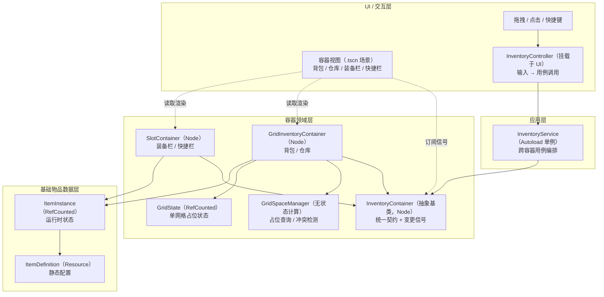

# 多容器物品栏架构（修订版）

> 本文档在原《多容器物品栏架构》方案基础上修订。核心分层不变，主要修正：GDScript 无 `interface` 的落地方式、`GridContainer` 与 Godot 内置类重名、补上「变更通知」机制、收窄 `GridSpaceManager` 职责、明确 `ItemInstance` 与堆叠的关系、落地结果类型与事务策略，并修正架构图箭头方向。

## 技术约定（Godot / GDScript）

| 对象 | Godot 类型 | 承载位置 |
|---|---|---|
| `ItemDefinition` | `Resource` | 编辑器配置（`.tres`） |
| `ItemInstance` | `RefCounted` | 纯运行时状态 |
| `InventoryContainer`（抽象基类） | `Node` | 挂载到对应 UI 场景 |
| `GridInventoryContainer` | `Node` | 挂载到背包 / 仓库 UI |
| `SlotContainer` | `Node` | 挂载到装备栏 / 快捷栏 UI |
| `GridState` | `RefCounted` | 由 `GridInventoryContainer` 持有，每容器一份 |
| `GridSpaceManager` | `RefCounted` | 无状态空间计算，供格子容器调用 |
| `InventoryService` | `Node`（Autoload 单例） | 全局单例，只编排、不持有物品数据 |

约定与原则：

- GDScript 没有 `interface` / `abstract` 关键字，`InventoryContainer` 用**抽象基类 + `class_name`** 表达契约：基类中需要覆盖的方法以 `push_error` 占位，子类 `extends` 后覆盖。
- 容器作为 `Node` 挂载到各自 UI 场景；其生命周期与所在 UI 场景一致。同一会话内 UI 以「显示 / 隐藏」方式管理，容器数据在会话内保持；跨会话持久化属于存档能力，**本次不实现**。
- UI 一律通过场景（`.tscn`）搭建，**禁止用代码硬编码创建控件**；视图脚本只负责渲染与订阅信号，不直接改容器数据。
- 全程低耦合、避免上帝类：领域对象各司其职，跨系统依赖通过信号/参数注入解耦。

## 设计目标

装备栏、快捷栏、背包、仓库都可以视为物品容器，但它们的规则不同：

- **格子容器**（背包、仓库）需要处理尺寸、占格、边界和空间冲突。
- **槽位容器**（装备栏、快捷栏）只需要处理固定槽位、槽位类型、数量限制等规则，不需要网格占位检查。
- 容器共用物品和操作契约；只有格子容器依赖空间管理能力。

因此，**GridSpaceManager 是格子容器的专属领域能力，不应放在所有容器都依赖的基础数据层**。基础数据描述物品；容器实现各自的存放规则；网格占位只由需要它的网格容器使用。

## 架构图



要点：

- `GridInventoryContainer` / `SlotContainer` 指向 `InventoryContainer` 表示「实现基类契约」（箭头从实现者指向被实现者）。
- `GridInventoryContainer` **持有** `GridState`（数据归属容器自身），**调用**无状态的 `GridSpaceManager` 做空间计算。
- `ItemInstance` 引用 `ItemDefinition`（实例指向定义，反向依赖不存在）。
- 视图层只「订阅信号 + 读取渲染」，不直接写容器数据；跨容器数据变更统一经 `InventoryService`。

## 模块职责

### UI / 交互层

负责展示容器、槽位和物品（`.tscn` 场景），并把拖拽、点击、快捷键等操作转成控制器命令。UI 可以按容器类型显示网格或槽位，但**不负责决定物品能否放置，也不直接修改容器数据**；它订阅容器信号，在数据变化后刷新显示。

### InventoryController

处理 UI 输入和交互上下文（拖拽起点、目标容器、目标格子或槽位）。它把用户意图翻译为 `InventoryService` 的用例调用，并把结果反馈给界面。**Controller 只做「输入 → 命令」的翻译，不维护占位规则，也不直接改容器数据。** 由于容器挂载在 UI 上，Controller 就近解析源/目标容器引用，作为参数传给 Service。

### InventoryService

Autoload 单例，负责应用层用例与事务编排：跨容器移动、拆分/合并堆叠、交换物品。它协调源容器移除与目标容器放入，并保证失败时数据一致。**Service 只编排、不持有物品数据；容器引用由调用方（Controller）传入，避免 Autoload 持有 UI 生命周期内的节点引用而产生悬挂引用。** 通过统一容器契约与容器交互：目标 `GridInventoryContainer` 执行网格规则，`SlotContainer` 执行槽位规则。

### InventoryContainer（抽象基类）

提供容器共用的领域契约：容器标识、查询、能否接受物品、以及「内容变化」信号。它**不包含**网格坐标、矩形占位等网格概念，也不包含槽位类型等槽位概念。定位相关的放入/取出方法下放到子类，避免一个通用的 `Add(item, location)` 在运行时接受含义不明的位置对象。

### GridInventoryContainer

用于背包、仓库等二维空间容器。**自身持有** `GridState`（占位状态）和网格尺寸、物品朝向等数据。放入时调用 `GridSpaceManager` 验证尺寸、边界与重叠；移除/移动时同步更新 `GridState`。定位操作以网格坐标表达（`try_put_at` / `try_take_at`）。

### SlotContainer

用于装备栏、快捷栏等固定槽位容器。维护槽位及其类型、数量限制和接受规则（例如头部装备槽只接受头部装备）。它**不依赖** `GridState` / `GridSpaceManager`，不做二维占位、矩形重叠或网格边界检查。定位操作以槽位 ID 表达（`try_put_to` / `try_take_from`）。

### GridSpaceManager

**无状态**的网格空间计算，只为 `GridInventoryContainer` 提供能力：判断占用区域是否越界或冲突、计算占格坐标、查询可放置位置。它**不存储**任何容器的占位状态（状态在 `GridState` 里，由容器持有），也不存储 `ItemDefinition` 静态配置。物品尺寸来自物品定义，管理器结合传入的 `GridState` 与尺寸做纯计算。若未来需要不同网格策略，可改为注入实例，但当前以静态方法即可。

### GridState

单个网格容器的占位状态（`RefCounted`），由 `GridInventoryContainer` 持有。记录「哪些格子被哪个物品实例占用」的映射，提供占用/释放、查询空闲等基础操作。**谁的数据谁持有**：每个格子容器一份，天然按容器隔离，不共享公共网格。

### ItemDefinition 与 ItemInstance

- **ItemDefinition**（`Resource`）：静态定义，描述物品类型共有数据，如显示资源、网格尺寸、能否旋转、能否堆叠、堆叠上限、装备类别、配方/产物等。其中图标等显示资源属于**配置数据的静态引用**，不是领域逻辑，仅作为资源引用存放，渲染逻辑不得进入定义层。
- **ItemInstance**（`RefCounted`）：运行时物品，包含唯一实例标识、数量、耐久、随机属性等状态，并引用其 `ItemDefinition`。

**堆叠模型**：一个 `ItemInstance` 即一个「可堆叠的栈单元」。占格面积只由 `ItemDefinition.size` 决定，**与数量无关**（例如 2×1 尺寸的物品，数量 99 仍占 2×1）。不可堆叠物品的 `quantity` 恒为 1，此时实例可携带耐久、随机属性等逐件状态。静态定义与运行时状态分离后，同类型物品共享配置，同时保留各自状态。

## 变更通知（信号）

领域层不感知 UI，数据变化通过信号向外通知，形成单向数据流：

- 每个容器声明 `contents_changed(container_id)` 信号，任何放入/移除/移动/交换后触发。
- UI 视图订阅所展示容器的该信号，收到后重读容器并刷新显示。
- 跨系统通知（例如「物品已拾取」这类需要其他系统响应的全局事件）经信号总线（Autoload）转发，容器不直接耦合到具体系统。

这样 Controller 只做命令翻译、View 只做渲染订阅，领域变化有唯一出口。

## 结果类型与事务

所有可能失败的操作统一返回 `InventoryResult`，避免 `bool + 隐式失败` 的歧义：

```gdscript
class_name InventoryResult
extends RefCounted

enum Code { OK, REJECTED, NO_SPACE, FULL, WRONG_SLOT, NOT_FOUND, STACK_LIMIT }
var code: Code
var reason: String
var leftover: ItemInstance  # 可选：容纳不下的剩余物品
```

`InventoryService` 的跨容器用例统一采用「**先校验、后提交**」：

1. 对源、目标容器分别做校验（`can_accept` + 目标的放置检查）；
2. 全部通过后，依次执行「源移除 → 目标放入」；
3. 若提交中途失败，按逆操作回滚（把已移除的放回源），并返回带原因的 `InventoryResult`。

内存容器无需两阶段提交；上述「校验通过再改、失败逆操作回滚」足以保证数据一致。

## 格子容器与槽位容器的边界

| 能力 | GridInventoryContainer（背包、仓库） | SlotContainer（装备栏、快捷栏） |
|---|---|---|
| 位置模型 | 二维坐标与占用区域 | 固定编号或具名槽位 |
| 放置校验 | 尺寸、边界、重叠、占位 | 槽位类型、容量、物品接受规则 |
| 空间能力 | 持有 GridState，调用 GridSpaceManager | 不使用 |
| 定位操作 | `try_put_at` / `try_take_at`（网格坐标） | `try_put_to` / `try_take_from`（槽位 ID） |
| 常见操作 | 找空位、旋转、整理、拖到坐标 | 装备、卸下、绑定快捷位、替换 |
| 数据布局 | ItemInstance + 锚点/占位索引 | 槽位到 ItemInstance 的映射 |

两种实现共享「容器」契约和跨容器用例，但不共享与自身无关的空间逻辑。`SlotContainer` 不必实现无意义的占位检查，网格规则也不会散落在服务层的大量类型分支中。

## 接口示意（GDScript 风格）

```gdscript
# 抽象基类：统一身份、查询、接受规则与变更信号。
class_name InventoryContainer
extends Node

signal contents_changed(container_id: StringName)

func get_container_id() -> StringName:
    push_error("必须覆盖"); return &""
func get_items() -> Array[ItemInstance]:
    push_error("必须覆盖"); return []
func can_accept(item: ItemInstance) -> InventoryResult:
    push_error("必须覆盖"); return InventoryResult.new()

# 定位相关的放入/取出下放到子类，基类不出现含义不明的 location。
```

```gdscript
class_name GridInventoryContainer
extends InventoryContainer

var grid_size: Vector2i
var grid_state: GridState        # 每容器一份，自己持有

func try_put_at(item: ItemInstance, pos: Vector2i) -> InventoryResult:
    pass  # 调用 GridSpaceManager 校验边界/重叠，再写入 GridState
func try_take_at(pos: Vector2i) -> InventoryResult:
    pass
```

```gdscript
class_name SlotContainer
extends InventoryContainer

var slots: Array[Slot]           # 槽位及其类型/容量/接受规则

func try_put_to(item: ItemInstance, slot_id: int) -> InventoryResult:
    pass  # 校验槽位类型与容量
func try_take_from(slot_id: int) -> InventoryResult:
    pass
```

```gdscript
class_name GridState
extends RefCounted

var size: Vector2i
var occupancy: Dictionary        # 格子坐标 -> 占用它的 ItemInstance

func is_cell_free(cell: Vector2i) -> bool: pass
func occupy(cells: Array[Vector2i], item: ItemInstance) -> void: pass
func free(cells: Array[Vector2i]) -> void: pass
```

```gdscript
class_name GridSpaceManager
extends RefCounted

static func can_place(grid: GridState, item_size: Vector2i, pos: Vector2i) -> bool: pass
static func occupied_cells(item_size: Vector2i, pos: Vector2i) -> Array[Vector2i]: pass
static func find_position(grid: GridState, item_size: Vector2i) -> Vector2i: pass  # (-1,-1) 未找到
```

```gdscript
# Autoload 单例：只编排，不持有数据；容器引用由调用方传入。
extends Node

func move_item(source: InventoryContainer, target: InventoryContainer,
               source_loc, target_loc) -> InventoryResult: pass
func split_stack(source: InventoryContainer, source_loc, amount: int,
                 target: InventoryContainer, target_loc) -> InventoryResult: pass
func merge_stack(source: InventoryContainer, source_loc,
                 target: InventoryContainer, target_loc) -> InventoryResult: pass
func swap_items(a: InventoryContainer, a_loc,
                b: InventoryContainer, b_loc) -> InventoryResult: pass
```

`Service` 内部用 `is GridInventoryContainer` / `is SlotContainer` 分派到「按坐标」或「按槽位」的定位操作，或按类型化命令分派，避免运行期解一个含义不明的位置对象。

## 本次不做

- **存档 / 序列化**：容器数据的跨会话持久化、存档加载均不实现，当前仅内存运行。
- 全局网格、跨容器共享的公共占用索引（占位状态一律容器私有）。

## 推荐实现顺序

1. **定义数据与结果类型**：建立 `ItemDefinition`、`ItemInstance`、`InventoryResult`，明确静态配置与运行时状态边界，以及堆叠/占格语义。
2. **定义容器基类契约**：`InventoryContainer` 抽象基类，确定容器标识、查询、能否接受物品与 `contents_changed` 信号。
3. **实现 SlotContainer**：先覆盖简单固定槽位规则，验证基类没有过度绑定网格。
4. **实现 GridState 与 GridSpaceManager**：容器私有占位状态 + 无状态空间计算。
5. **实现 GridInventoryContainer**：持有 GridState，接入 GridSpaceManager，完成尺寸、坐标、放入、移除与移动规则。
6. **实现 InventoryService**：编排容器间移动、堆叠拆分/合并、交换，落地「先校验后提交 + 逆操作回滚」。
7. **接入 Controller 与 UI**：按容器类型用 `.tscn` 场景展示交互，视图订阅容器信号，Controller 把输入转成用例调用并传入容器引用。
8. **补充扩展规则**：在具体容器中扩展装备限制、快捷栏过滤、网格旋转、自动整理等策略。

先验证槽位与网格可共享哪些容器能力，再添加网格专属机制，有助于保持基类精简，并让 `GridSpaceManager` 的职责限定在需要空间占位的容器上。
